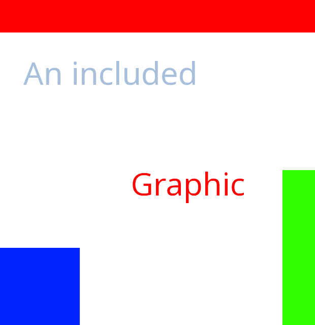

# Quarto layout issue involving tables

## Issue

When a floating graphic is placed on the next page, the presence of a table on that next page will cause the text to continue beyond the bottom margin. The issue does not happen if instead of the table, there is another figure.

## To reproduce the issue

1. Create a text. Insert a Figure between certain paragraphs, and insert a table a few paragraphs later. After the table, insert plenty of more paragraphs.

2. Render the pdf.

3. Insert paragraphs before the Figure such that the remaining space on the same page is not enough

4. Render the pdf.

**Expected result:** Some paragraphs after the Figure are continued on the same page until the bottom margin. The figure is moved to the other page. *Text after the table correctly flows to to the subsequent space.*

**Observed result:** *Text after the table continues onto the bottom margin of the page*

# Demonstration

After the next paragraph, we insert @fig-label. After that, we insert two other paragraph and a simple table. Render the document and see the layout. Then uncomment the paragraph below, and render again to see the issue.

Deleting this paragraph will free enough room for the figure on the current page to fit @fig-label. It will then remain on the current page, and there will be no issue with the text and table that follows after.

{#fig-label width=20%}

**Before Table --2** He heard quiet steps behind him. That didn't bode well. Who could be following him this late at night and in this deadbeat part of town? And at this particular moment, just after he pulled off the big time and was making off with the greenbacks. Was there another crook who'd had the same idea, and was now watching him and waiting for a chance to grab the fruit of his labor? Or did the steps behind him mean that one of many law officers in town was on to him and just waiting to pounce and snap those cuffs on his wrists? He nervously looked all around. Suddenly he saw the alley. Like lightning he darted off to the left and disappeared between the two warehouses almost falling over the trash can lying in the middle of the sidewalk.

**Before Table --1** He tried to nervously tap his way along in the inky darkness and suddenly stiffened: it was a dead-end, he would have to go back the way he had come. The steps got louder and louder, he saw the black outline of a figure coming around the corner. Is this the end of the line? he thought pressing himself back against the wall trying to make himself invisible in the dark, was all that planning and energy wasted? He was dripping with sweat now, cold and wet, he could smell the fear coming off his clothes. Suddenly next to him, with a barely noticeable squeak, a door swung quietly to and fro in the night's breeze. Could this be the haven he'd prayed for? Slowly he slid toward the door, pressing himself more and more into the wall, into the dark, away from his enemy. Would this door save his hide?

Table: A simple table that will cause layout issues when the figure above is moved to the next page. {#tbl-label}

| Header 1   | Header 2 | Header 3 |
| :--------- | :------: | :------: |
| Item 1     | 1        | 4        |
| Item 2     | 2        | 5        |
| Item 3     | 3        | 6        |

**After Table 1**. He heard quiet steps behind him. That didn't bode well. Who could be following him this late at night and in this deadbeat part of town? And at this particular moment, just after he pulled off the big time and was making off with the greenbacks. Was there another crook who'd had the same idea, and was now watching him and waiting for a chance to grab the fruit of his labor? Or did the steps behind him mean that one of many law officers in town was on to him and just waiting to pounce and snap those cuffs on his wrists? He nervously looked all around. Suddenly he saw the alley. Like lightning he darted off to the left and disappeared between the two warehouses almost falling over the trash can lying in the middle of the sidewalk.

**After Table 2**. He tried to nervously tap his way along in the inky darkness and suddenly stiffened: it was a dead-end, he would have to go back the way he had come. The steps got louder and louder, he saw the black outline of a figure coming around the corner. Is this the end of the line? he thought pressing himself back against the wall trying to make himself invisible in the dark, was all that planning and energy wasted? He was dripping with sweat now, cold and wet, he could smell the fear coming off his clothes. Suddenly next to him, with a barely noticeable squeak, a door swung quietly to and fro in the night's breeze. Could this be the haven he'd prayed for? Slowly he slid toward the door, pressing himself more and more into the wall, into the dark, away from his enemy. Would this door save his hide?

**After Table 3**. He heard quiet steps behind him. That didn't bode well. Who could be following him this late at night and in this deadbeat part of town? And at this particular moment, just after he pulled off the big time and was making off with the greenbacks. Was there another crook who'd had the same idea, and was now watching him and waiting for a chance to grab the fruit of his labor? Or did the steps behind him mean that one of many law officers in town was on to him and just waiting to pounce and snap those cuffs on his wrists? He nervously looked all around. Suddenly he saw the alley. Like lightning he darted off to the left and disappeared between the two warehouses almost falling over the trash can lying in the middle of the sidewalk.

**After Table 4**. He tried to nervously tap his way along in the inky darkness and suddenly stiffened: it was a dead-end, he would have to go back the way he had come. The steps got louder and louder, he saw the black outline of a figure coming around the corner. Is this the end of the line? he thought pressing himself back against the wall trying to make himself invisible in the dark, was all that planning and energy wasted? He was dripping with sweat now, cold and wet, he could smell the fear coming off his clothes. Suddenly next to him, with a barely noticeable squeak, a door swung quietly to and fro in the night's breeze. Could this be the haven he'd prayed for? Slowly he slid toward the door, pressing himself more and more into the wall, into the dark, away from his enemy. Would this door save his hide?

